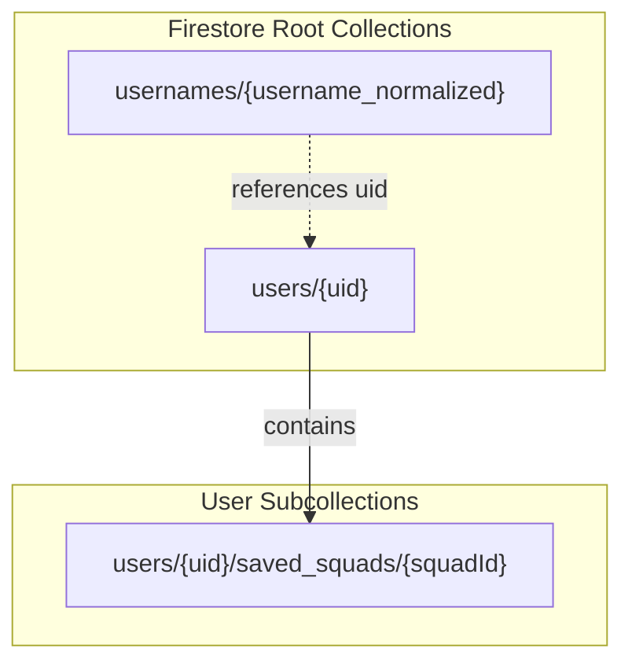
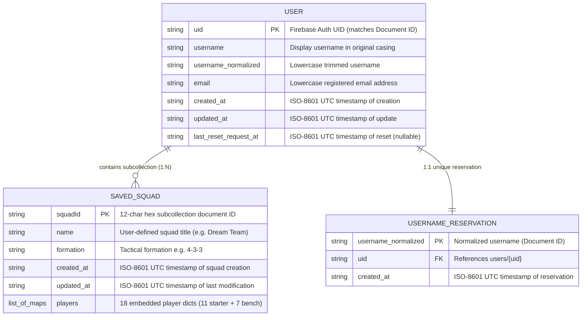

# KickoffXI — Firestore Data Model & Architecture Specification

## 1. Overview & Architecture Shift

KickoffXI previously utilized an embedded SQLite database (`instance/saved_squads.db`) to store user accounts, password reset OTPs, saved squads, and squad-player associations. 

With this migration, user authentication and persistent user data transition to **Firebase Authentication** and **Cloud Firestore** using the Firebase Admin SDK for Python:
- **Authentication**: Managed by Firebase Authentication (passwords and credentials stored securely off-server; Identity Toolkit REST used server-side for password verification).
- **Session Management**: Firebase Session Cookies (HttpOnly, SameSite=Lax, Secure in production) managed by Flask.
- **Data Storage**: Cloud Firestore (Asia-Southeast1 / Singapore) for user profiles, username uniqueness, and user-owned saved squads.
- **Access Control**: Server-side only via Firebase Admin SDK. All direct client-side reads and writes are denied via Firestore Security Rules.

> **Note on Data Modeling Deliverables**: In a relational architecture, entity-relationship (ER) diagrams represent foreign keys, joins, and relational normal forms. In NoSQL document databases like Cloud Firestore, relational schemas are replaced by **Document-Collection Hierarchies**, subcollections for hierarchical containment, and transactional reservation documents.



### Logical Data Model (ER-Style Schema)



---

## 2. Document Collections & Schemas

### 2.1 Collection: `users/{uid}`
Stores the core profile and metadata for each user account. The document ID is the Firebase Authentication `uid`.

| Field Name | Type | Description |
|---|---|---|
| `uid` | `string` | Firebase Auth UID (matches document ID) |
| `username` | `string` | Display username in original casing (e.g. `Seth Rollins`) |
| `username_normalized` | `string` | Lowercase trimmed username (e.g. `seth rollins`) |
| `email` | `string` | Lowercase registered email address |
| `created_at` | `string` | ISO-8601 UTC timestamp of account creation |
| `updated_at` | `string` | ISO-8601 UTC timestamp of last profile update |
| `last_reset_request_at` | `string \| null` | ISO-8601 UTC timestamp of last password reset request (for 60s throttle) |

---

### 2.2 Collection: `usernames/{username_normalized}`
Dedicated lookup collection used to guarantee global username uniqueness via Firestore transactions. The document ID is the normalized username.

| Field Name | Type | Description |
|---|---|---|
| `uid` | `string` | Associated Firebase Auth UID |
| `created_at` | `string` | ISO-8601 UTC timestamp when username was reserved |

#### Username Rules:
- **New signups**: 3–20 characters matching `^[a-zA-Z0-9_.-]{3,20}$`.
- **Normalization**: `username.strip().lower()`.
- **Document ID Compliance**: Non-empty, no `/`, not `.` or `..`, does not match `__.*__`, maximum 1500 bytes UTF-8.

---

### 2.3 Subcollection: `users/{uid}/saved_squads/{squadId}`
Hierarchical subcollection scoped strictly to the owning user. 
- Auto-generated ID (12-char hex) for all user squads.

| Field Name | Type | Description |
|---|---|---|
| `name` | `string` | User-defined squad name (e.g. `Champions XI`) |
| `formation` | `string` | Formation identifier (e.g. `4-3-3`, `4-2-3-1`, `3-5-2`) |
| `created_at` | `string` | ISO-8601 UTC timestamp of squad creation |
| `updated_at` | `string` | ISO-8601 UTC timestamp of last update |
| `players` | `array<map>` | Ordered list of 18 players (11 starters + 7 bench) |

#### Player Map Structure in `players`:
| Field Name | Type | Example / Description |
|---|---|---|
| `player_key` | `string` | Stable player key `<slug(nationality)>:<slug(name)>` (e.g. `france:kylian-mbappe`) |
| `role` | `string` | `'starter'` or `'bench'` |
| `slot` | `string` | Starter slot index (`'0'`..`'10'`) or bench category (`'GK'`, `'DEF'`, `'MID'`, `'ATT'`) |

---

## 3. Security & Access Model

1. **Deny-All Client Security Rules (`firestore.rules`)**:
   ```javascript
   rules_version = '2';
   service cloud.firestore {
     match /databases/{database}/documents {
       match /{document=**} {
         allow read, write: if false;
       }
     }
   }
   ```
2. **Structural Ownership**:
   - Squad documents reside under `users/{uid}/saved_squads/`.
   - The user ID is **never taken from user input or request bodies**; it is verified cryptographically from the signed Firebase session cookie.
   - Any attempt to access, update, duplicate, or delete a squad with an ID not belonging to the authenticated user's subcollection yields a `404 Not Found`.

---

## 4. Concurrency Control and Data Integrity

This section documents the concurrency model and transactional guarantees implemented in KickoffXI across Firebase Authentication and Cloud Firestore:

1. **Username Uniqueness via Firestore Transactions**:
   - The reservation of a username in `usernames/{username_normalized}` and the creation of `users/{uid}` are executed together inside an atomic `@firestore.transactional` block.
   - If two concurrent registration requests attempt to claim the same username, Firestore detects the read-write conflict; one transaction succeeds while the other encounters the reserved record and raises `UsernameAlreadyTakenError`.

2. **Password-Reset Cooldown via Atomic Transactions**:
   - The 60-second password reset cooldown is evaluated and updated using `@firestore.transactional`.
   - The transaction reads `last_reset_request_at`, verifies the cooldown period, and applies `transaction.set(user_ref, {'last_reset_request_at': now_iso, 'updated_at': now_iso}, merge=True)`.
   - Using `merge=True` ensures cooldown tracking functions atomically even if the user's Firestore profile document was not previously created or is temporarily missing, preventing cooldown bypasses.

3. **Atomic Document-Level Squad Writes**:
   - Each saved squad is stored as a single, self-contained document in `users/{uid}/saved_squads/{squadId}`, including its metadata and 18 player associations.
   - In Firestore, individual document writes (`doc_ref.set()`, `doc_ref.update()`) are inherently atomic.
   - Squad updates execute directly against `doc_ref.update(...)` without redundant pre-reads. If another request concurrently deletes the squad, Firestore throws a `NotFound` exception, which is caught to return a clean `404 Not Found` response rather than reporting a false success or crashing.

4. **Cryptographic Ownership Enforcement**:
   - All Firestore document paths are structurally partitioned under `users/{uid}/`.
   - The `uid` is never accepted from client payloads or request URLs; it is cryptographically extracted and verified on every request from the server-side Firebase session cookie (`kxi_session`).

5. **Automatic Conflict Retries**:
   - The Google Cloud Firestore client automatically manages optimistic concurrency control and retries transaction conflicts with exponential backoff.
   - No custom retry-on-lock logic is required in application code.

6. **Soft Cap on Saved Squads**:
   - The 50-squad user quota is enforced as a **soft limit**. Before creating or duplicating a squad, the collection is counted. If the count reaches 50, a `SquadLimitReachedError` is raised and mapped to an HTTP 400 error.
   - Because creation does not employ a global counter lock or cross-document transaction across the entire subcollection, simultaneous requests may slightly exceed the 50-squad threshold under high concurrency. This intentional trade-off avoids distributed lock contention and keeps squad creation fast.

7. **Dual-Store Boundary (Firebase Auth vs. Firestore)**:
   - Firebase Authentication and Cloud Firestore are independent distributed services and do not participate in a single two-phase distributed transaction.
   - Account creation creates the Firebase Auth user first and then creates the Firestore profile documents transactionally. If profile creation fails, compensating cleanup logic is triggered.

> **Note on Distributed Guarantees**: While critical state transitions (username reservation, profile creation, password reset cooldown, document updates) are guarded by Firestore ACID transactions or atomic operations, the application is not claimed to be completely race-condition-free across all distributed boundaries (e.g., simultaneous creation against the soft squad quota).

---

## 5. Indexes

Because queries are strictly targeted:
- `users/{uid}` by document ID
- `usernames/{username_normalized}` by document ID
- `users/{uid}/saved_squads` sorted in Python memory or single-field indexed by `updated_at`

**No composite indexes are required.** All operations rely exclusively on document-ID lookups and subcollection streams.

