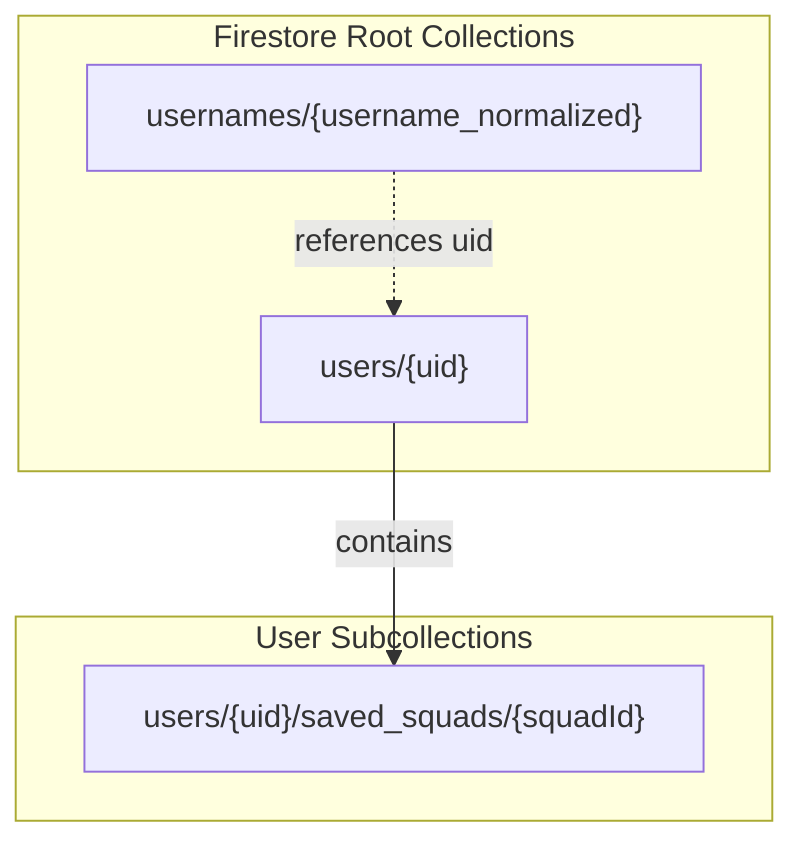

# KickoffXI — Firestore Data Model & Architecture Specification

## 1. Overview & Architecture Shift

KickoffXI previously utilized an embedded SQLite database (`instance/saved_squads.db`) to store user accounts, password reset OTPs, saved squads, and squad-player associations. 

With this migration, user authentication and persistent user data transition to **Firebase Authentication** and **Cloud Firestore** using the Firebase Admin SDK for Python:
- **Authentication**: Managed by Firebase Authentication (passwords and credentials stored securely off-server; Identity Toolkit REST used server-side for password verification).
- **Session Management**: Firebase Session Cookies (HttpOnly, SameSite=Lax, Secure in production) managed by Flask.
- **Data Storage**: Cloud Firestore (Asia-Southeast1 / Singapore) for user profiles, username uniqueness, and user-owned saved squads.
- **Access Control**: Server-side only via Firebase Admin SDK. All direct client-side reads and writes are denied via Firestore Security Rules.

> **Note on Data Modeling Deliverables**: In a relational architecture, entity-relationship (ER) diagrams represent foreign keys, joins, and relational normal forms. In NoSQL document databases like Cloud Firestore, relational schemas are replaced by **Document-Collection Hierarchies**, subcollections for hierarchical containment, and transactional reservation documents.



---

## 2. Document Collections & Schemas

### 2.1 Collection: `users/{uid}`
Stores the core profile and metadata for each user account. The document ID is the Firebase Authentication `uid`.

| Field Name | Type | Description |
|---|---|---|
| `uid` | `string` | Firebase Auth UID (matches document ID) |
| `username` | `string` | Display username in original casing (e.g. `Seth Rollins`) |
| `username_normalized` | `string` | Lowercase trimmed username (e.g. `seth rollins`) |
| `email` | `string` | Lowercase registered email address |
| `created_at` | `string` | ISO-8601 UTC timestamp of account creation |
| `updated_at` | `string` | ISO-8601 UTC timestamp of last profile update |
| `last_reset_request_at` | `string \| null` | ISO-8601 UTC timestamp of last password reset request (for 60s throttle) |

---

### 2.2 Collection: `usernames/{username_normalized}`
Dedicated lookup collection used to guarantee global username uniqueness via Firestore transactions. The document ID is the normalized username.

| Field Name | Type | Description |
|---|---|---|
| `uid` | `string` | Associated Firebase Auth UID |
| `created_at` | `string` | ISO-8601 UTC timestamp when username was reserved |

#### Username Rules:
- **New signups**: 3–20 characters matching `^[a-zA-Z0-9_.-]{3,20}$`.
- **Normalization**: `username.strip().lower()`.
- **Document ID Compliance**: Non-empty, no `/`, not `.` or `..`, does not match `__.*__`, maximum 1500 bytes UTF-8.

---

### 2.3 Subcollection: `users/{uid}/saved_squads/{squadId}`
Hierarchical subcollection scoped strictly to the owning user. 
- Auto-generated ID (12-char hex) for all user squads.

| Field Name | Type | Description |
|---|---|---|
| `name` | `string` | User-defined squad name (e.g. `Champions XI`) |
| `formation` | `string` | Formation identifier (e.g. `4-3-3`, `4-2-3-1`, `3-5-2`) |
| `created_at` | `string` | ISO-8601 UTC timestamp of squad creation |
| `updated_at` | `string` | ISO-8601 UTC timestamp of last update |
| `players` | `array<map>` | Ordered list of 18 players (11 starters + 7 bench) |

#### Player Map Structure in `players`:
| Field Name | Type | Example / Description |
|---|---|---|
| `player_key` | `string` | Stable player key `<slug(nationality)>:<slug(name)>` (e.g. `france:kylian-mbappe`) |
| `role` | `string` | `'starter'` or `'bench'` |
| `slot` | `string` | Starter slot index (`'0'`..`'10'`) or bench category (`'GK'`, `'DEF'`, `'MID'`, `'ATT'`) |

---

## 3. Security & Access Model

1. **Deny-All Client Security Rules (`firestore.rules`)**:
   ```javascript
   rules_version = '2';
   service cloud.firestore {
     match /databases/{database}/documents {
       match /{document=**} {
         allow read, write: if false;
       }
     }
   }
   ```
2. **Structural Ownership**:
   - Squad documents reside under `users/{uid}/saved_squads/`.
   - The user ID is **never taken from user input or request bodies**; it is verified cryptographically from the signed Firebase session cookie.
   - Any attempt to access, update, duplicate, or delete a squad with an ID not belonging to the authenticated user's subcollection yields a `404 Not Found`.

---

## 5. Indexes

Because queries are strictly targeted:
- `users/{uid}` by document ID
- `usernames/{username_normalized}` by document ID
- `users/{uid}/saved_squads` sorted in Python memory or single-field indexed by `updated_at`

**No composite indexes are required.** All operations rely exclusively on document-ID lookups and subcollection streams.

